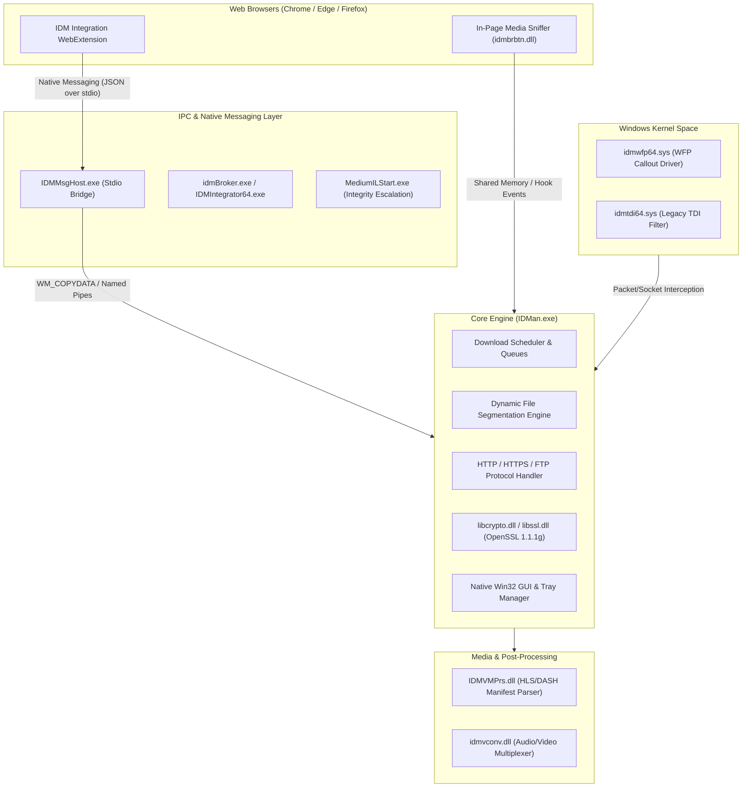

# Internet Download Manager (IDM) — Technical Architecture & Complete Documentation

Internet Download Manager (**IDM**, main binary [`IDMan.exe`](file:///C:/Program%20Files%20(x86)/Internet%20Download%20Manager/IDMan.exe)) is a commercial multi-threaded download accelerator and network stream manager for Microsoft Windows, developed by **Tonec Inc.** 

This document provides a complete technical analysis of the application: programming languages used across each subsystem, multi-process architecture, dynamic segmentation algorithms, browser interception mechanisms, kernel-level network drivers, and an exhaustive directory inventory.

---

## 1. High-Level Architectural Overview

IDM uses a decoupled, hybrid architecture composed of:
1. **A Native 32-bit Win32 Core GUI & Engine** ([`IDMan.exe`](file:///C:/Program%20Files%20(x86)/Internet%20Download%20Manager/IDMan.exe)).
2. **Native Messaging Hosts & Helpers** ([`IDMMsgHost.exe`](file:///C:/Program%20Files%20(x86)/Internet%20Download%20Manager/IDMMsgHost.exe), [`idmBroker.exe`](file:///C:/Program%20Files%20(x86)/Internet%20Download%20Manager/idmBroker.exe), [`MediumILStart.exe`](file:///C:/Program%20Files%20(x86)/Internet%20Download%20Manager/MediumILStart.exe)).
3. **Kernel-Mode Network Filtering Drivers** (`idmwfp64.sys`, `idmtdi64.sys`).
4. **Browser Integration Modules** (WebExtensions for Chrome, Edge, Firefox, and Opera, coupled with in-process Hook DLLs).
5. **Streaming Media Parsers & Conversion Utilities** ([`IDMVMPrs.dll`](file:///C:/Program%20Files%20(x86)/Internet%20Download%20Manager/IDMVMPrs.dll), [`idmvconv.dll`](file:///C:/Program%20Files%20(x86)/Internet%20Download%20Manager/idmvconv.dll)).



---

## 2. Programming Languages & Technology Stack

IDM was constructed using high-performance, low-level native languages without reliance on heavy managed runtimes (such as .NET or Java) or web wrappers (such as Electron). This design achieves sub-second launch times, minimal working set memory (~10–30 MB RAM), and deterministic network throughput.

| Subsystem / Layer | Language(s) Used | Compiler / Toolchain & Libraries | Rationale |
| :--- | :--- | :--- | :--- |
| **Main Core Engine (`IDMan.exe`)** | **C / Native C++** | Microsoft Visual C++ (MSVC 9.0), pure Win32 API | Maximizes execution speed, thread scheduling predictability, and zero-runtime dependency deployment across all Windows versions. |
| **Kernel Drivers (`.sys`)** | **C** | Windows Driver Kit (WDK), Windows Filtering Platform (WFP) | Kernel-level packet inspection, socket diversion, and transport-level filtering. |
| **Browser Helper Objects & Hooks** | **C++ (COM)** | Microsoft ATL / Win32 COM APIs (`IShellExtInit`, `IContextMenu`) | In-process injection into Windows Explorer and web browsers. |
| **Browser Extensions (`.crx`, `.xpi`)** | **JavaScript / HTML / CSS** | WebExtensions API (Chrome Manifest V2/V3, Firefox WebExtensions) | Cross-browser click interception, media link detection, and native messaging communication. |
| **Cryptography & TLS** | **C** | OpenSSL v1.1.1g (`libcrypto.dll`, `libssl.dll`) | High-performance TLS 1.2 / TLS 1.3 encrypted transport for secure HTTP downloads. |
| **Compression** | **C** | Google Brotli (`brotli-license.txt`) / Deflate | Real-time decompression of HTTP responses compressed with `Content-Encoding: br` or `gzip`. |
| **Media Parsing & Multiplexing** | **C / C++** | Custom native MPEG-TS/MP4/HLS demuxers (`idmvconv.dll`, `IDMVMPrs.dll`) | Fast assembly of chunked audio/video segments into coherent container files. |

---

## 3. Core Architectural Systems & Features

### 3.1. Dynamic File Segmentation Engine
Traditional download accelerators partition a target file into fixed segments before starting (e.g., segment 1: 0–25%, segment 2: 25–50%, etc.). If one connection degrades or finishes early, the bandwidth remains underutilized.

IDM uses **Dynamic File Segmentation**:
* It establishes an initial set of connections using HTTP `Range: bytes=start-end` requests.
* When any connection completes its chunk or another connection stalls, the active segment is subdivided on the fly into smaller byte ranges.
* IDM reallocates and redirects available connections without closing the connection or corrupting file continuity.
* Temporary chunk files are stored in `%APPDATA%\..\Roaming\IDM\DwnlData\...` and stitched into the destination file upon completion.

### 3.2. Browser Integration & Click Interception
IDM intercepts file downloads through multiple coordinated techniques:
1. **WebExtension & Native Messaging**: The browser extension detects download events (`chrome.downloads.onDeterminingFilename` or link click events) and passes the URL, referer, cookies, user-agent, and POST data to [`IDMMsgHost.exe`](file:///C:/Program%20Files%20(x86)/Internet%20Download%20Manager/IDMMsgHost.exe) over standard I/O streams using JSON.
2. **Keyboard Modifier Rules**:
   * Holding **`Insert`** (configurable) forces IDM to intercept any clicked link.
   * Holding **`Alt`** suppresses IDM interception, forcing the browser's native download manager to handle the transfer.
3. **File Type Filtering**: Automatic interception based on file extension matching configured in [`defexclist.txt`](file:///C:/Program%20Files%20(x86)/Internet%20Download%20Manager/defexclist.txt) and user preferences.

### 3.3. Streaming Media Detection & Video Download Panel
* **Dynamic Stream Sniffing**: The injected module ([`idmbrbtn.dll`](file:///C:/Program%20Files%20(x86)/Internet%20Download%20Manager/idmbrbtn.dll) / `idmbrbtn64.dll`) renders a native floating overlay panel directly above HTML5 `<video>` and `<audio>` elements.
* **Manifest Parsing**: [`IDMVMPrs.dll`](file:///C:/Program%20Files%20(x86)/Internet%20Download%20Manager/IDMVMPrs.dll) detects streaming protocols:
  * **HLS (HTTP Live Streaming)** `.m3u8` playlists.
  * **MPEG-DASH** `.mpd` manifests.
  * Fragmented MP4 (fMP4) and MPEG-TS stream slices.
* **Audio/Video Multiplexing**: If the provider serves video and audio streams as separate tracks (e.g., 1080p/4K adaptive video without integrated audio), IDM downloads both tracks simultaneously and utilizes [`idmvconv.dll`](file:///C:/Program%20Files%20(x86)/Internet%20Download%20Manager/idmvconv.dll) to remux them into a single playable container (`.mp4` or `.mkv`).

### 3.4. Kernel-Level Network Monitoring (WFP & TDI)
* **Windows Filtering Platform Driver (`idmwfp64.sys`)**: A kernel-mode callout driver that intercepts raw TCP sockets across all processes. This ensures IDM captures download streams even from applications or browsers lacking dedicated extensions.
* **Transport Driver Interface (`idmtdi64.sys`)**: A legacy filter driver maintained for legacy Windows platforms.
* **User-Mode Coordination**: [`IDMNetMon64.dll`](file:///C:/Program%20Files%20(x86)/Internet%20Download%20Manager/IDMNetMon64.dll) interfaces directly with the kernel filter driver to divert HTTP streams into IDM's queue.

### 3.5. Queue Management & Scheduler
* **Dual Queues**: Default support for **Main Download Queue** and **Synchronization Queue**, with support for custom queues.
* **Timed Scheduling**: Automated execution at specific hours, days of the week, or recurring intervals.
* **Post-Execution Triggers**: Automatic modem hang-up, VPN disconnection, Wi-Fi disabling, and machine shutdown or sleep upon download completion.

### 3.6. Site Grabber (Web Crawler)
* Managed by [`IDMGrHlp.exe`](file:///C:/Program%20Files%20(x86)/Internet%20Download%20Manager/IDMGrHlp.exe).
* Recursively crawls domains up to a specified link depth.
* Filters content by asset types (e.g., only images, only audio files, complete website mirroring for offline browsing).

### 3.7. Speed Limiter
* Employs token-bucket rate limiting algorithms to throttle individual downloads or aggregate bandwidth, preventing network congestion.

---

## 4. Complete Directory & File Inventory

Below is an itemized inventory of all components installed in [`C:\Program Files (x86)\Internet Download Manager\`](file:///C:/Program%20Files%20(x86)/Internet%20Download%20Manager/):

### 4.1. Core Executables (`.exe`)

| File Name | Architecture | Purpose & Function |
| :--- | :--- | :--- |
| [`IDMan.exe`](file:///C:/Program%20Files%20(x86)/Internet%20Download%20Manager/IDMan.exe) | 32-bit x86 | Main GUI executable, multi-part download coordinator, scheduler, and system tray manager. |
| [`IDMMsgHost.exe`](file:///C:/Program%20Files%20(x86)/Internet%20Download%20Manager/IDMMsgHost.exe) | 32-bit x86 | Chromium and Firefox Native Messaging host communicating via standard I/O (`stdio`). |
| [`idmBroker.exe`](file:///C:/Program%20Files%20(x86)/Internet%20Download%20Manager/idmBroker.exe) | 32-bit x86 | 64-bit OS registry and setting reader broker. |
| [`IDMIntegrator64.exe`](file:///C:/Program%20Files%20(x86)/Internet%20Download%20Manager/IDMIntegrator64.exe) | 64-bit x64 | Integration loader for injecting and registering 64-bit hooks into 64-bit processes. |
| [`MediumILStart.exe`](file:///C:/Program%20Files%20(x86)/Internet%20Download%20Manager/MediumILStart.exe) | 32-bit x86 | Facilitates execution at Medium Integrity Level when called from Low Integrity browser sandboxes. |
| [`IDMGrHlp.exe`](file:///C:/Program%20Files%20(x86)/Internet%20Download%20Manager/IDMGrHlp.exe) | 32-bit x86 | Helper executable for the IDM Site Grabber subsystem. |
| [`IEMonitor.exe`](file:///C:/Program%20Files%20(x86)/Internet%20Download%20Manager/IEMonitor.exe) | 32-bit x86 | Click monitor and download interceptor for Internet Explorer and WebBrowser controls. |
| [`Uninstall.exe`](file:///C:/Program%20Files%20(x86)/Internet%20Download%20Manager/Uninstall.exe) | 32-bit x86 | Application uninstaller and system registration cleaner. |

### 4.2. Dynamic Link Libraries (`.dll`)

| File Name | Purpose |
| :--- | :--- |
| `idmbrbtn.dll` / `idmbrbtn64.dll` | Renders the in-browser floating "Download this video" panel. |
| `idmcchandler2.dll` / `idmcchandler2_64.dll` | Browser click-catcher handler module for Chromium-based engines. |
| `idmcchandler7.dll` / `idmcchandler7_64.dll` | Advanced click-catcher handler module for modern browser releases. |
| `IDMNetMon.dll` / `IDMNetMon64.dll` | User-mode network monitor communicating with kernel filtering drivers. |
| `IDMVMPrs.dll` / `IDMVMPrs64.dll` | Streaming video and audio media manifest parser (HLS, DASH). |
| `idmvconv.dll` | Media stream converter and container multiplexer. |
| `IDMShellExt.dll` / `IDMShellExt64.dll` | Windows File Explorer shell context menu integration. |
| `IDMIECC.dll` / `IDMIECC64.dll` | Internet Explorer Browser Helper Object (BHO). |
| `IDMGetAll.dll` / `IDMGetAll64.dll` | "Download All Links with IDM" browser context menu module. |
| `idmfsa.dll` | IDM file system assistant module. |
| `idmftype.dll` / `IDMFType64.dll` | File type and MIME detection helper. |
| `idmindex.dll` | Download list indexing and quick search module. |
| `idmmkb.dll` | Keyboard hook module for hotkey detection (`Insert`, `Alt`). |
| `idmnmcl.dll` | Native messaging client library. |
| `idmvs.dll` | Version validation and compatibility module. |
| `libcrypto.dll` | OpenSSL 1.1.1g cryptographic primitives. |
| `libssl.dll` | OpenSSL 1.1.1g TLS/SSL protocol support. |

### 4.3. Kernel Drivers (`.sys`)

| File Name | Architecture | Function |
| :--- | :--- | :--- |
| `idmwfp32.sys` | 32-bit x86 | Windows Filtering Platform (WFP) network callout driver. |
| `idmwfp64.sys` | 64-bit x64 | 64-bit WFP network callout driver for 64-bit Windows. |
| `idmwfpAA.sys` | ARM64 / Alt | WFP driver for alternative CPU architectures. |
| `idmtdi32.sys` | 32-bit x86 | Legacy Transport Driver Interface (TDI) network driver. |
| `idmtdi64.sys` | 64-bit x64 | 64-bit legacy TDI network driver. |

### 4.4. Browser Extensions & Manifests

| File Name | Target Platform / Type | Description |
| :--- | :--- | :--- |
| [`IDMMsgHost.json`](file:///C:/Program%20Files%20(x86)/Internet%20Download%20Manager/IDMMsgHost.json) | Chromium Manifest | Native messaging registration for Chrome, Edge, Brave, and Opera. |
| [`IDMMsgHostMoz.json`](file:///C:/Program%20Files%20(x86)/Internet%20Download%20Manager/IDMMsgHostMoz.json) | Firefox Manifest | Native messaging registration for Mozilla Firefox. |
| `IDMGCExt.crx` / `IDMGCExt59.crx` | Google Chrome | Packaged extension files for Chromium browsers. |
| `IDMEdgeExt.crx` | Microsoft Edge | Packaged extension file for Edge. |
| `idmmzcc3.xpi` | Firefox | Packaged extension for Firefox (WebExtensions standard). |
| `IDMOpExt.nex` | Opera | Packaged extension for Opera. |

### 4.5. Data & Configuration Files

| File Name | Content & Purpose |
| :--- | :--- |
| [`defexclist.txt`](file:///C:/Program%20Files%20(x86)/Internet%20Download%20Manager/defexclist.txt) | Default domain and URL exclusion list (prevents intercepting unwanted sites). |
| [`tips.txt`](file:///C:/Program%20Files%20(x86)/Internet%20Download%20Manager/tips.txt) | User tips displayed on startup or help dialogs. |
| `idmfc.dat` / `IDMFType.dat` | Binary definition tables for recognized file signatures and MIME types. |
| `idmantypeinfo.tlb` | Type library exposing IDM automation interfaces via COM/OLE. |
| [`Languages/`](file:///C:/Program%20Files%20(x86)/Internet%20Download%20Manager/Languages/) | Directory containing string localization resources for 35+ languages. |
| [`Toolbar/`](file:///C:/Program%20Files%20(x86)/Internet%20Download%20Manager/Toolbar/) | Directory storing custom bitmap toolbar skins, button sets, and icons. |
| `*.chm` | Compiled HTML Help documentation files (`idman.chm`, `grabber.chm`, `scheduler.chm`, `tutor.chm`). |

---

## 5. Command-Line Interface (CLI) Reference

IDM provides a complete command-line interface that allows external scripts, automation tools, and applications to trigger downloads:

```bash
IDMan.exe [/d URL] [/s] [/p local_path] [/f local_file_name] [/q] [/h] [/n] [/a]
```

### Parameter Reference
* **`/d URL`**: Initiates downloading of the specified file URL (e.g., `IDMan.exe /d "https://example.com/file.zip"`).
* **`/s`**: Starts processing the active download queue in the scheduler.
* **`/p local_path`**: Defines the target directory where the downloaded file will be saved.
* **`/f local_file_name`**: Overrides the target file name on disk.
* **`/q`**: Instructs IDM to exit automatically after all downloads complete (must be combined with `/n`).
* **`/h`**: Disconnects dial-up / VPN connections upon download completion.
* **`/n`**: Activates silent mode; suppresses all confirmation and progress dialogs.
* **`/a`**: Enqueues the URL into the download queue without starting it immediately.

---

## 6. Security & Execution Privilege Model

* **Standard User Context**: [`IDMan.exe`](file:///C:/Program%20Files%20(x86)/Internet%20Download%20Manager/IDMan.exe) executes with `asInvoker` privileges under standard user tokens. It does not require continuous administrative access for routine operations.
* **Sandbox Traversal**: Because modern browser processes operate within restricted AppContainer or Low Integrity Level sandboxes, [`MediumILStart.exe`](file:///C:/Program%20Files%20(x86)/Internet%20Download%20Manager/MediumILStart.exe) bridges requests to ensure downloads execute with the user's standard permissions.
* **Kernel Integrity**: The WFP network drivers are code-signed with valid Microsoft Authenticode certificates (`DigiCert Trusted G4`), satisfying Windows Kernel Mode Code Signing (KMCS) requirements on 64-bit editions of Windows.
