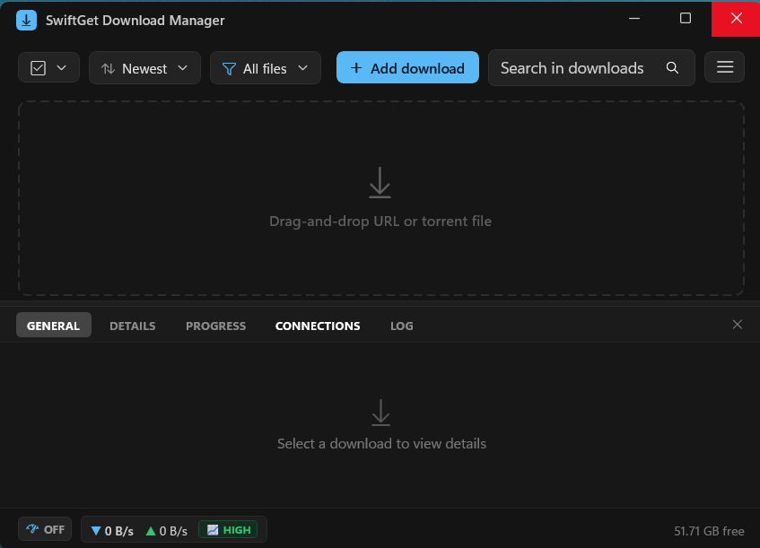
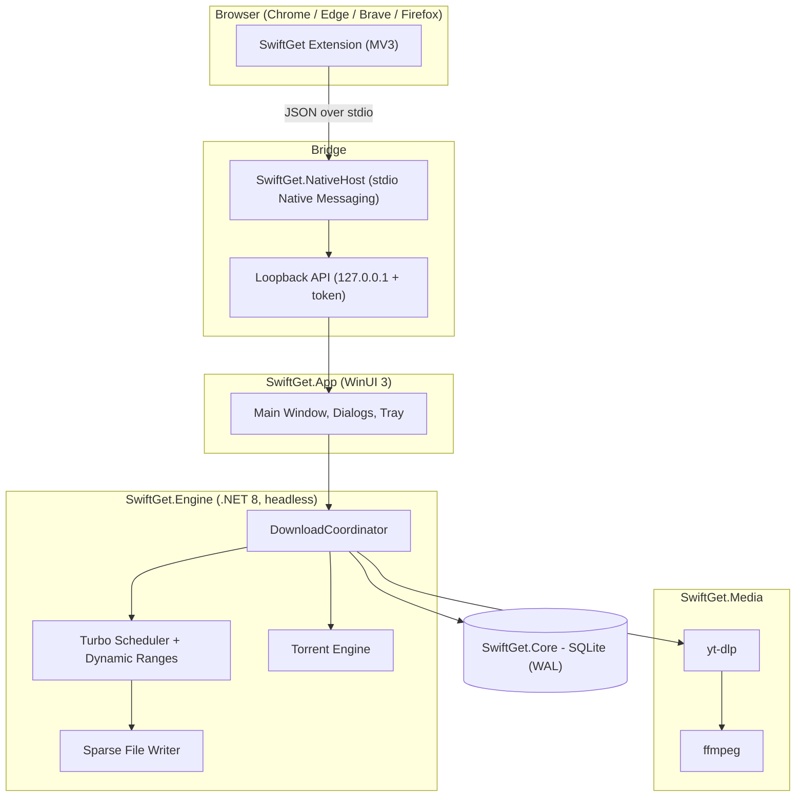

# SwiftGet Download Manager

**SwiftGet Download Manager** is a fast download accelerator for Windows 10 and Windows 11. It splits each download across multiple connections, resumes interrupted transfers, and catches downloads straight from your browser. It also handles streaming media (YouTube and other sites via `yt-dlp` + `ffmpeg`) and BitTorrent.

Under the hood it is built on C# 12 / .NET 8, WinUI 3 and SQLite, and it ships as a self-contained WiX MSI installer.



## Download

| File | Description |
| :--- | :--- |
| [SwiftGet-1.0.0-x64.msi](https://github.com/judinme/Swiftget-Download-Manager/releases/download/v1.0.0/SwiftGet-1.0.0-x64.msi) | Windows installer (x64, self-contained) |
| [swiftget-chromium-v1.0.0.zip](https://github.com/judinme/Swiftget-Download-Manager/releases/download/v1.0.0/swiftget-chromium-v1.0.0.zip) | Browser extension for Chrome, Edge, Brave and Opera |
| [swiftget-firefox-v1.0.0.xpi](https://github.com/judinme/Swiftget-Download-Manager/releases/download/v1.0.0/swiftget-firefox-v1.0.0.xpi) | Browser extension for Firefox |

All files and their SHA-256 checksums are on the [v1.0.0 release page](https://github.com/judinme/Swiftget-Download-Manager/releases/tag/v1.0.0).

---

## Features

- **Multi-connection downloads (Turbo Engine)**: dynamic range scheduling with 1–32 connections per file. Idle connections split the largest remaining range at its midpoint.
- **No merge step**: segments are written directly into one pre-allocated sparse file, so the file is ready as soon as the last byte arrives.
- **Pause, resume and crash recovery**: segment checkpoints are persisted to SQLite (WAL mode), and expired signed links are refreshed automatically.
- **Stall protection**: a 30-second read watchdog runs on every connection. A stalled range is handed back to the scheduler and picked up by another worker.
- **Download queue**: configurable concurrency (default 3 simultaneous downloads, range 1–10), with a scheduler and categories (Compressed, Documents, Music, Programs, Video, General).
- **Browser integration**: an MV3 extension for Chrome, Edge and Brave, plus a Firefox extension, connected through a Native Messaging host.
  - Only captures downloads the user starts *live*. Captures carry a session time guard, a 15-second TTL and idempotency IDs, so old browser history is never replayed.
  - Shows a "Download this video" button on supported media pages.
- **Streaming media**: YouTube and other sites through signature-verified `yt-dlp` / `ffmpeg` sidecars, with format and quality selection. Media downloads run directly in the main list.
- **BitTorrent**: magnet links and `.torrent` files (MonoTorrent), with protocol encryption and anti-stall handling.
- **Speed limiter**: global and per-download token-bucket limits.
- **Familiar UI**: a main list with a bottom inspector (General / Details / Progress / Connections / Log), a per-file progress window with a live segment bar, and system tray integration.
- **Security**: authenticated loopback API (127.0.0.1, random port, token), Mark-of-the-Web tagging, optional antivirus scan after download, and filename sanitization.

---

## Architecture



| Project | Purpose |
| :--- | :--- |
| `src/SwiftGet.Core` | Models, enums, settings, SQLite storage and migrations |
| `src/SwiftGet.Engine` | Probing, segmentation, Turbo engine, queue, torrent, loopback server, browser-capture gatekeeper |
| `src/SwiftGet.Media` | `yt-dlp` / `ffmpeg` sidecar management, stream recorder |
| `src/SwiftGet.NativeHost` | Native Messaging host for the browser extension |
| `src/SwiftGet.App` | WinUI 3 desktop application (MVVM, CommunityToolkit.Mvvm) |
| `extension/` | Chromium MV3 and Firefox browser extension |
| `installer/` | WiX v4/v5 MSI package and winget manifest |
| `tests/` | Unit, integration, property, fault-injection, Turbo harness and UI automation tests |
| `benchmarks/` | BenchmarkDotNet throughput benchmarks |

See [docs/architecture.md](docs/architecture.md) for the full design, [docs/api-spec.md](docs/api-spec.md) for the loopback API and [docs/threat-model.md](docs/threat-model.md) for security.

---

## System Requirements

- Windows 10 version 1809 (build 17763) or later, or Windows 11, on **x64**.
- No separate .NET or Windows App SDK install is needed (the app is self-contained).

---

## Installation

### 1. Install the app

1. Download `SwiftGet-1.0.0-x64.msi` from the [Releases](https://github.com/judinme/Swiftget-Download-Manager/releases) page.
2. Run it and follow the setup wizard. If Windows SmartScreen warns about an unknown publisher, click **More info → Run anyway** (the installer is not code-signed yet).
3. The installer also registers the native messaging host that connects the browser extension to the app.

### 2. Install the browser extension

**Chrome / Edge / Brave / Opera**

1. Download `swiftget-chromium-v1.0.0.zip` and extract it to a permanent folder, for example `C:\SwiftGet-Extension`. Don't delete this folder later, because the browser loads the extension from it.
2. Open `chrome://extensions` (or `edge://extensions` in Edge, `brave://extensions` in Brave).
3. Turn on **Developer mode**.
4. Click **Load unpacked** and select the extracted folder.
5. Check that the extension ID is `albogoggaijdbgdldghgfcjakpdbmmfm`. That is the ID the installer authorizes for native messaging.

**Firefox**

1. Download `swiftget-firefox-v1.0.0.xpi`.
2. Open `about:debugging#/runtime/this-firefox`, click **Load Temporary Add-on…** and select the `.xpi`.
   The add-on is not signed by Mozilla yet, so release builds of Firefox remove it when the browser restarts. Firefox Developer Edition or Nightly with `xpinstall.signatures.required = false` can install it permanently.

---

## Building from Source

### Prerequisites

- .NET 8 SDK
- Visual Studio 2022 with the *Windows application development* (WinUI 3 / Windows App SDK) workload
- WiX Toolset v4/v5 (only needed for the MSI)
- Node.js 18+ (only needed for the extension tests)

### Build and run

```powershell
git clone https://github.com/judinme/Swiftget-Download-Manager.git
cd Swiftget-Download-Manager
dotnet build SwiftGet.sln -c Release -p:Platform=x64
dotnet run --project src/SwiftGet.App -c Release
```

### Run tests

```powershell
dotnet test tests/SwiftGet.Engine.Tests
dotnet test tests/SwiftGet.Turbo.Harness
dotnet test tests/SwiftGet.App.Tests
node --test tests/extension.test.mjs
```

### Package the MSI installer

```powershell
pwsh scripts/package.ps1 -Configuration Release -Version 1.0.0
```

The packaging script writes these to `dist/`:

- `SwiftGet-1.0.0-x64.msi` (single embedded cabinet)
- the browser extension packages
- SHA-256 checksums
- the winget manifest and `updates.json`

---

## Configuration

These settings are under **Menu → Options**:

| Setting | Default | Description |
| :--- | :--- | :--- |
| Maximum concurrent downloads | 3 | Downloads running at the same time. The rest wait in the queue. |
| Connections per download | 8 | Maximum parallel connections per file |
| Show progress dialog for streaming media | Off | Media downloads run in the main list without a popup |
| Delete partial files on cancel | Off | Removes incomplete data when you cancel a download |

User data is stored under `%LOCALAPPDATA%\SwiftGet`.

---

## Changelog

See [CHANGELOG.md](CHANGELOG.md).

---

## Disclaimer

SwiftGet uses its own branding, visual assets and code. It does not bypass DRM or other content protection. You are responsible for following the terms of service of the sites you download from.
