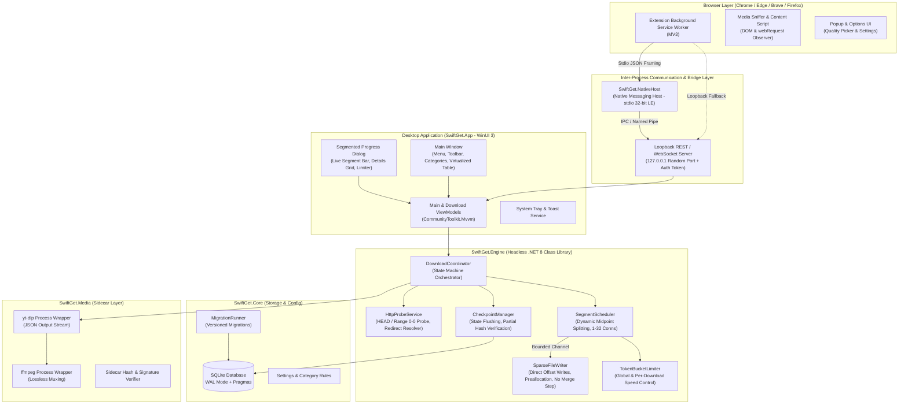
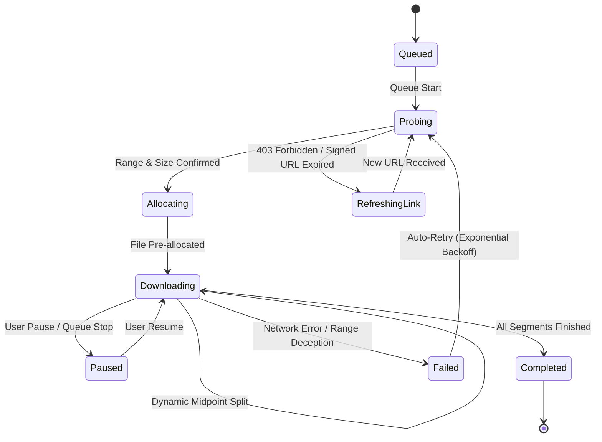

# SwiftGet Architecture Blueprint

## 1. Executive Architecture Overview

SwiftGet is engineered as an enterprise-grade, IDM-class download accelerator for Windows 10/11. The system is split into distinct architectural layers with strict separation of concerns:
- **Headless Core Engine (`SwiftGet.Engine`)**: Pure C# 12 / .NET 8 library with zero UI and zero Windows-only dependencies. Responsible for probing, dynamic multi-connection segmentation, sparse disk I/O, bandwidth limiting, retry resilience, and resume state.
- **Data & Configuration Layer (`SwiftGet.Core`)**: SQLite storage in Write-Ahead Logging (WAL) mode, schema migrations, and settings repository.
- **Desktop Interface (`SwiftGet.App`)**: High-performance WinUI 3 desktop application running unpackaged and self-contained. Employs MVVM via `CommunityToolkit.Mvvm`, compiled bindings (`x:Bind`), and virtualized list containers capable of handling 10,000+ items at 60 fps.
- **Browser Extension (`extension/`) & Native Bridge (`SwiftGet.NativeHost`)**: Chromium (MV3) and Firefox browser extension intercepting downloads and sniffer streams, communicating over a standard I/O native messaging host with an authenticated loopback REST/WebSocket fallback API.
- **Media Engine (`SwiftGet.Media`)**: Managed, signature-verified sidecar orchestration of `yt-dlp` and `ffmpeg` with DRM detection and safe non-circumvention policies.

---

## 2. Component Diagram



---

## 3. Dynamic Connection Splitting & Write-At Architecture

### Sparse File Direct Write-At (No-Merge Invariant)
Traditional download managers write chunks into separate temporary `.part` files on disk (e.g. `file.bin.001`, `file.bin.002`) and execute an expensive concatenation/merge step upon completion. For multi-gigabyte files, this leads to double disk space consumption and long end-of-download freezes.

SwiftGet operates strictly via single-file random-access sparse writes:
1. When a download initiates with known `TotalBytes`, `SparseFileWriter` pre-allocates the complete target file using Win32 `FSCTL_SET_SPARSE` and `SetLength`.
2. Each concurrent `SegmentWorker` streams its byte range directly into its allocated physical file offset via thread-safe OS `RandomAccess.WriteAsync`.
3. When the final segment completes, zero merge step is required; the file handle is flushed to disk and the download is immediately ready.

### Dynamic Midpoint Splitting
When an active connection completes its assigned byte range earlier than others (or when bandwidth headroom permits increasing connections up to the configured limit, between 1 and 32 connections):
- The `DynamicSplitter` finds the active unfinished segment with the largest remaining work (`maxRemaining = EndOffset - CurrentOffset + 1`).
- If `maxRemaining >= minSplitSize` (default: 1 MB), the remaining range is split at the exact midpoint:
  - Existing segment range is reduced: `EndOffset = splitPoint - 1`.
  - A new segment is created: `StartOffset = splitPoint`, `CurrentOffset = splitPoint`, `EndOffset = oldEnd`.
- The newly spawned worker connects with HTTP header `Range: bytes=splitPoint-oldEnd`.
- State snapshots are cloned and persisted to SQLite asynchronously.

---

## 4. Download State Machine



---

## 5. Storage Schema & SQLite Configuration

SwiftGet uses SQLite in Write-Ahead Logging (WAL) mode for maximum concurrency:
- `PRAGMA journal_mode = WAL;`
- `PRAGMA synchronous = NORMAL;`
- `PRAGMA foreign_keys = ON;`
- `PRAGMA busy_timeout = 5000;`

### Database Entities
```sql
CREATE TABLE IF NOT EXISTS downloads (
    id TEXT PRIMARY KEY,
    url TEXT NOT NULL,
    final_url TEXT,
    file_name TEXT NOT NULL,
    destination_path TEXT NOT NULL,
    total_bytes INTEGER NOT NULL DEFAULT 0,
    downloaded_bytes INTEGER NOT NULL DEFAULT 0,
    status TEXT NOT NULL,
    etag TEXT,
    last_modified TEXT,
    content_type TEXT,
    supports_ranges INTEGER NOT NULL DEFAULT 1,
    checksum_expected TEXT,
    checksum_actual TEXT,
    checksum_type TEXT,
    created_at_utc TEXT NOT NULL,
    completed_at_utc TEXT,
    error_message TEXT,
    retry_count INTEGER NOT NULL DEFAULT 0,
    speed_limit_bytes_per_sec INTEGER NOT NULL DEFAULT 0,
    queue_id TEXT NOT NULL REFERENCES queues(id) ON DELETE CASCADE,
    category_id TEXT NOT NULL REFERENCES categories(id) ON DELETE RESTRICT,
    priority INTEGER NOT NULL DEFAULT 0,
    referrer TEXT,
    user_agent TEXT,
    custom_headers_json TEXT,
    cookies_json TEXT
);

CREATE TABLE IF NOT EXISTS segments (
    id TEXT PRIMARY KEY,
    download_id TEXT NOT NULL REFERENCES downloads(id) ON DELETE CASCADE,
    segment_index INTEGER NOT NULL,
    start_offset INTEGER NOT NULL,
    end_offset INTEGER NOT NULL,
    current_offset INTEGER NOT NULL,
    status TEXT NOT NULL,
    connection_id INTEGER,
    updated_at_utc TEXT NOT NULL,
    checksum TEXT
);

CREATE INDEX IF NOT EXISTS idx_downloads_status ON downloads(status);
CREATE INDEX IF NOT EXISTS idx_downloads_queue_id ON downloads(queue_id);
CREATE INDEX IF NOT EXISTS idx_segments_download_id ON segments(download_id);
CREATE INDEX IF NOT EXISTS idx_segments_download_offset ON segments(download_id, start_offset);
```
