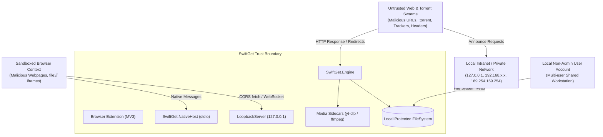

# SwiftGet Security Threat Model & Defense Architecture

This document outlines the threat modeling, trust boundaries, vulnerability remediations, and defense-in-depth controls implemented across SwiftGet.

---

## 1. Trust Boundaries & Attack Surfaces



---

## 2. Threat Matrix (STRIDE Analysis)

| Threat ID | STRIDE Category | Threat Description | Architectural Mitigation | Status |
|---|---|---|---|---|
| **C-01** | Elevation of Privilege / Tampering | Remote web page or attacker injects directory traversal paths (`../../Startup/evil.bat`) into loopback `fileName` or `destinationPath`. | `FileNameSanitizer.Sanitize` strips traversal sequences, NTFS alternate data streams, and reserved device names. Target paths are strictly resolved under designated category directories via `PathTraversalGuard.EnsureSafePath`. Absolute destination paths from clients are rejected. | Remediated (Task 1) |
| **C-02** | Remote Code Execution | Attacker embeds shell meta-characters (`" & calc.exe`) in media URLs, titles, or filenames passed to sidecars (`yt-dlp`, `ffmpeg`). | Discontinued string-based command line interpolation. All process executions strictly use `ProcessStartInfo.ArgumentList` array tokens with `UseShellExecute = false`. Disallowed embedded quotes and control characters. | Remediated (Task 2) |
| **C-03** | Arbitrary File Deletion | Malicious `.torrent` file contains paths escaping `SaveDirectory` (e.g. `../../../Windows/System32/file.dll`). When user removes download with `deleteFiles: true`, engine deletes arbitrary files outside the save directory. | `MonoTorrentEngine.RemoveAsync` validates every file deletion path against `TorrentPathSanitizer.GetSafeFullPath`. Trailing directory separators are strictly enforced before prefix matching; any path escaping the base is safely skipped. | Remediated (Task 3) |
| **C-04** | Server-Side Request Forgery (SSRF) | Malicious torrent/magnet contains tracker URLs pointing to loopback or intranet services (`http://169.254.169.254/latest/meta-data`, `http://192.168.1.1/admin`). | `TrackerSafetyValidator` filters unsafe trackers prior to passing magnet links or torrent tiers to the client engine. Intranet and loopback announce URLs are dropped unless explicitly permitted by configuration. | Remediated (Task 4) |
| **H-01** | Denial of Service (OOM) | Attacker sends multi-gigabyte POST requests or giant base64 payloads to loopback server, causing Out-Of-Memory termination. | Implemented strict request body limits: `Content-Length` and stream reads are capped at 2 MB. Base64 encoded torrent payloads are capped at 10 MB decoded length prior to deserialization. | Remediated (Task 1) |
| **H-06** | Information Disclosure / Spoofing | Auth token stored world-readable on disk; token validation suffers from timing oracle length leaks. | Token file written with restricted Windows DACL granting `CurrentUser` only. Token verification implemented using fixed-time SHA-256 hash comparison. | Remediated (Task 6) |
| **H-07** | Spoofing / Unauthorized Access | Native messaging host manifest allows wildcard origins (`chrome-extension://*/`). | Wildcard removed. Host manifest strictly pins verified extension IDs (`jidfbhpjcelebmiokljcmmljbfgiiolh`, `swiftget-extension-id`). | Remediated (Task 10) |
| **H-09** | Cross-Origin Request Forgery | Browser `file://` HTML or sandboxed iframe sends requests with `Origin: null` and bypasses CORS checks. | `IsAllowedOrigin("null")` returns `false`. Wildcard `Access-Control-Allow-Origin: *` headers are completely removed from loopback responses. | Remediated (Task 6) |
| **H-11** | Tampering / Downgrade Attack | Attacker feeds older signed update manifest or replayed installer to roll back to a vulnerable version. | `UpdateService` enforces HTTPS feeds, rejects manifests where `version <= currentVersion` or `version < minSupportedVersion`, and verifies cryptographic SHA-256 hashes before executing installers via `ArgumentList`. | Remediated (Task 7) |
| **H-12** | Binary Planting | Malicious executable placed in user directory or PATH is executed as sidecar binary. | Binary discovery removed PATH scanning fallback; prioritizes bundled verified executables with SHA-256 allowlist verification. | Remediated (Task 2/8) |
| **H-15** | Arbitrary Command Execution | Malicious download queue configuration triggers automated shutdown or arbitrary shell script upon completion. | All system shutdown/suspend actions require user confirmation with a 30-second cancellation window. Custom shell commands prohibit command chaining operators (`&`, `\|`, `;`, `>`, `<`, `` ` ``). | Remediated (Task 9) |

---

## 3. Defense-in-Depth Implementation Details

### 3.1 Input Sanitization & Path Traversal Guards
All user-supplied and network-supplied file names pass through `FileNameSanitizer.Sanitize()`:
- Converts path separators (`/`, `\`, `../`, `..\`) into underscores.
- Filters Unicode bidirectional override characters (RLO `\u202E`, LRO `\u202D`) used to disguise malicious executable extensions.
- Detects Windows reserved device names (`CON`, `PRN`, `AUX`, `NUL`, `COM1-9`, `LPT1-9`) and prepends underscores (`_CON.txt`).
- Enforces a 250-character limit while strictly preserving the file extension.

### 3.2 Secure Process Spawning
Processes (`yt-dlp`, `ffmpeg`, `msiexec`) are spawned strictly using `ProcessStartInfo.ArgumentList`:
```csharp
var psi = new ProcessStartInfo
{
    FileName = binaryPath,
    UseShellExecute = false,
    RedirectStandardOutput = true,
    RedirectStandardError = true,
    CreateNoWindow = true
};
foreach (var arg in argumentList)
{
    psi.ArgumentList.Add(arg);
}
```
This guarantees that arguments containing spaces, quotes, or shell control characters are passed directly to the operating system's `argv` array without passing through `cmd.exe` or `powershell.exe`.

### 3.3 Constant-Time Authentication
To prevent timing attacks that leak auth token lengths or prefixes:
```csharp
public bool ValidateToken(string? providedToken)
{
    if (string.IsNullOrEmpty(providedToken)) return false;
    var expectedHash = SHA256.HashData(Encoding.UTF8.GetBytes(_token));
    var providedHash = SHA256.HashData(Encoding.UTF8.GetBytes(providedToken));
    return CryptographicOperations.FixedTimeEquals(expectedHash, providedHash);
}
```
Comparing fixed-size SHA-256 hashes ensures constant execution time regardless of token length or character match count.
