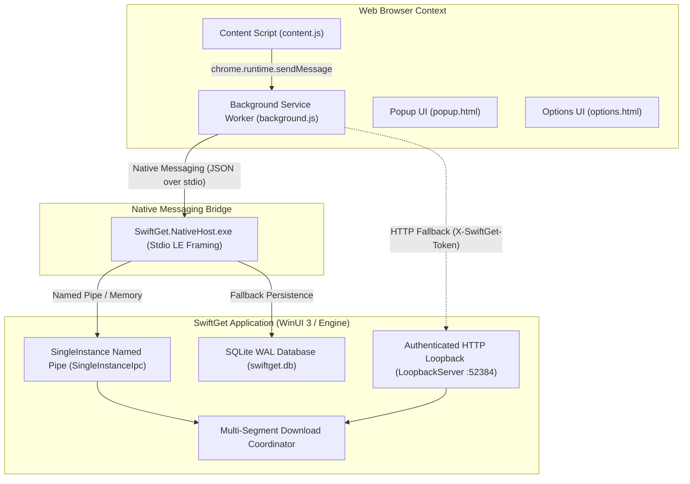

# SwiftGet Browser Integration Extension

The **SwiftGet Integration Extension** delivers 100% IDM-parity browser interception and media sniffing across all modern web browsers. It coordinates click interception, session header handoff, keyboard modifiers, BitTorrent capture, and video/audio stream sniffing between browser sandboxes and the SwiftGet Core Engine.

---

## 1. Target Browsers & Compatibility

| Browser | Manifest Engine | Platform Standard | Package Output |
| :--- | :--- | :--- | :--- |
| **Google Chrome** | Manifest V3 | Chromium Extensions | `swiftget-chromium-v1.0.0.zip` |
| **Microsoft Edge** | Manifest V3 | Chromium Extensions | `swiftget-chromium-v1.0.0.zip` |
| **Brave Browser** | Manifest V3 | Chromium Extensions | `swiftget-chromium-v1.0.0.zip` |
| **Opera / Vivaldi** | Manifest V3 | Chromium Extensions | `swiftget-chromium-v1.0.0.zip` |
| **Mozilla Firefox** | WebExtensions (MV3) | Gecko Add-ons (`gecko.id: "swiftget@swiftget.net"`) | `swiftget-firefox-v1.0.0.xpi` |

---

## 2. Core Architectural Features (IDM Parity)

### 2.1. Dynamic Click & Download Interception
* **Browser Download Event Interception**: Intercepts `chrome.downloads.onCreated`, cancels native browser downloads, erases the download history trace, and forwards the transfer to SwiftGet.
* **File Type Filtering**: Automatically intercepts files matching configured extensions (`.zip`, `.iso`, `.exe`, `.msi`, `.mp4`, `.mkv`, `.pdf`, `.tar.gz`, etc.).
* **Site Exclusion List (`defexclist.txt`)**: Ignores search engines, online banking, and authentication portals (e.g., `google.com`, `paypal.com`, `login.microsoftonline.com`).

### 2.2. Keyboard Modifier Rules
SwiftGet replicates IDM's exact hotkey controls:
* **Holding `Insert` (Force Download)**: Forces SwiftGet to capture and download ANY clicked link immediately, bypassing the file extension list.
* **Holding `Alt` (Bypass Download)**: Completely suppresses SwiftGet interception, allowing the browser's native download manager to handle the transfer.

### 2.3. Streaming Media Detection & 4-Stage IDM Flow
Injected content script (`content.js` + `sniffer.css`) provides a complete 4-stage media grabber workflow:
1. **Stage 1 — Floating Overlay Button**: A stylish floating button (`Download this video` / `Download this audio`) positioned above active HTML5 `<video>` and `<audio>` players.
2. **Stage 2 — Format & Quality Dropdown**: Displays numbered streams with resolutions (1080p, 720p, 480p, 360p, 144p, MP3/AAC audio), file formats, and estimated sizes, plus a **Download all** batch option.
3. **Stage 3 — "Download File Info" Modal**: Dialog allowing users to review destination URL, select Category, customize "Save As" file path, remember folder preference, and trigger **Start Download** or **Download Later**.
4. **Stage 4 — "Download complete" Modal**: Completion dialog with **Open**, **Open with...**, **Open folder**, and a draggable file badge icon for immediate drag-and-drop into target applications.

### 2.4. BitTorrent & Magnet Capture
* Automatically captures clicks on `magnet:?xt=urn:btih:...` links.
* Intercepts `.torrent` downloads and `application/x-bittorrent` MIME types.
* Pre-fetches `.torrent` metadata bytes while preserving browser session cookies for private tracker authentication.

### 2.5. Deep Session Handoff
Transfers complete HTTP context to SwiftGet to bypass authentication walls and one-time download tokens:
* Session cookies (`Cookie` header)
* `Referer` URL
* Complete browser `User-Agent`
* POST data payloads and authorization headers

---

## 3. Communication Bridge Architecture



---

## 4. Building & Packaging Extensions

To package the extensions for distribution, run:

```powershell
pwsh scripts/build-extension.ps1
```

This generates:
* `dist/extension/swiftget-chromium-v1.0.0.zip` (for Chrome, Edge, Brave, Opera)
* `dist/extension/swiftget-firefox-v1.0.0.xpi` (for Firefox)
* `dist/extension/checksums.json` (SHA-256 verification hashes)

---

## 5. Browser Installation Guide

### 5.1. Google Chrome / Brave / Opera
1. Open `chrome://extensions` (or `brave://extensions`, `opera://extensions`).
2. Enable **Developer mode** (toggle in the top-right corner).
3. Click **Load unpacked**.
4. Select the `d:\SwiftGet\extension\` directory.
5. The SwiftGet extension icon will appear in your browser toolbar.

### 5.2. Microsoft Edge
1. Open `edge://extensions`.
2. Enable **Developer mode** in the left sidebar.
3. Click **Load unpacked** and choose `d:\SwiftGet\extension\`.

### 5.3. Mozilla Firefox
1. Open `about:debugging#/runtime/this-firefox`.
2. Click **Load Temporary Add-on...**.
3. Select `d:\SwiftGet\extension\manifest.firefox.json` (or the packaged `dist/extension/swiftget-firefox-v1.0.0.xpi`).
4. The extension will register with Gecko ID `swiftget@swiftget.net`.

### 5.4. Native Host Registration
Run the registration script once to link your installed browsers with SwiftGet's native messaging host:

```powershell
pwsh scripts/install-native-host.ps1
```

Registry locations configured:
* `HKCU:\Software\Google\Chrome\NativeMessagingHosts\com.swiftget.downloader`
* `HKCU:\Software\Microsoft\Edge\NativeMessagingHosts\com.swiftget.downloader`
* `HKCU:\Software\BraveSoftware\Brave-Browser\NativeMessagingHosts\com.swiftget.downloader`
* `HKCU:\Software\Mozilla\NativeMessagingHosts\com.swiftget.downloader`

---

## 6. Automated Testing

Verify the complete extension test suite:

```powershell
node --test tests/extension.test.mjs
```
